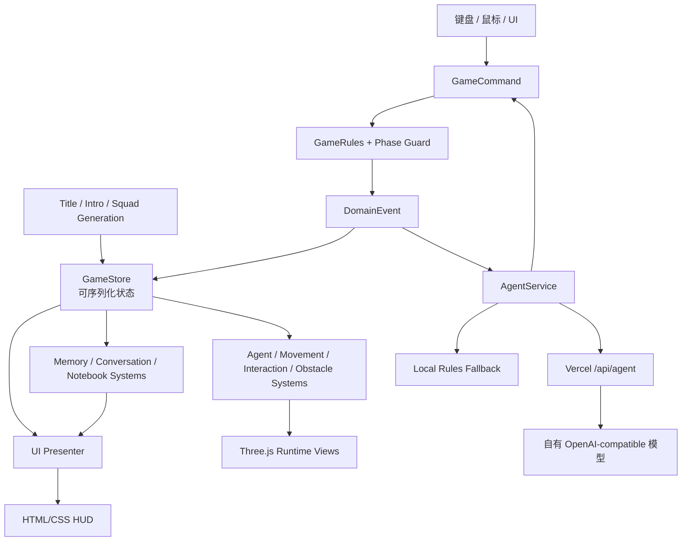
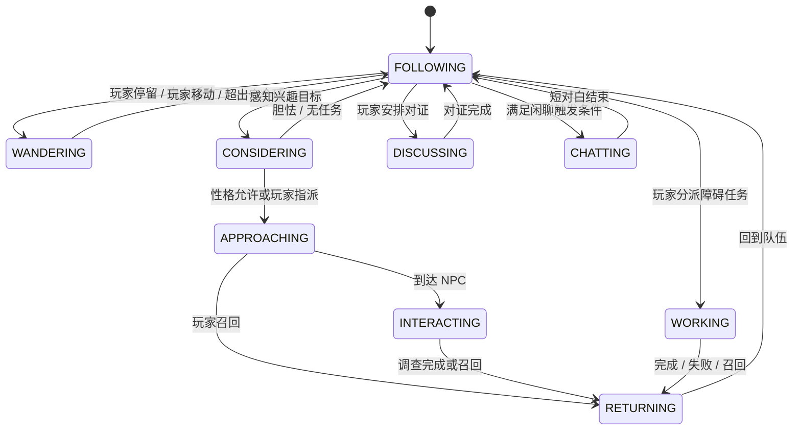
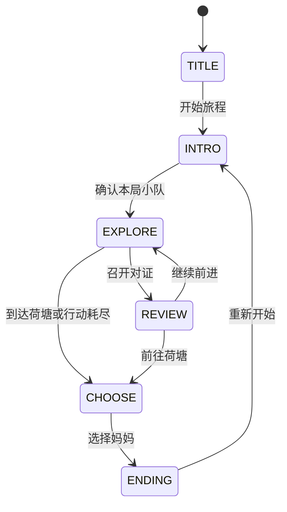

# 《Who is Mom》游戏开发架构与迭代计划

> 版本：0.3 / Demo 与扩展版目标架构
>
> 平台：桌面 Web，Vercel 部署
>
> 技术栈：Vite + TypeScript + Three.js + 原生 HTML/CSS
>
> 模型接入：OpenAI-compatible Chat Completions，经 Vercel Function 代理
>
> 美术方向：低面数 3D + 三渲二卡通色阶，参考《Lil Gator Game》的明快自然世界

> 当前实现说明：本文同时保留 Demo 之后的目标架构与演进蓝图。当前仓库实际存在的文件、运行链路和维护入口以 `PROJECT_STRUCTURE.md` 为准。

---

## 1. 架构目标

这套架构服务于两个看似冲突的目标：

1. 一名熟悉 TypeScript 和 Three.js 的开发者能在 8-10 个有效工时内做出完整玩法闭环；
2. Demo 验证成立后，可以继续增加妈妈档案、河段、NPC、性格和模型能力，而不重写核心循环。

首日只验证一个问题：

> 玩家是否会因为蝌蚪的性格、有限记忆和信息传播方式，主动做出分派、召回、复查与对证决策？

### 1.1 三条工程原则

- **真相确定，理解生成**：妈妈身份、NPC 事实和胜负来自本地数据；模型只选择、遗漏、压缩和转述已有事实。
- **帧循环同步，AI 事件异步**：移动和状态机每帧执行；模型只在调查完成和对证开始时调用。
- **按领域分层，不做完整 ECS**：使用小型 Store、系统函数和对象工厂；不引入通用实体组件框架。
- **规则生成，AI 表达**：队伍模板、能力范围和关卡可解性由本地规则保证；AI 只生成名字、口吻、简短观点和受约束的理解结果。
- **所有变化可追溯**：关键记忆、心理状态、玩家记录和任务结果都写入事件日志，结算不得依赖临时 UI 文本。

### 1.2 首日质量取舍

项目约束选择“快 + 可验证”，品质通过缩小范围保证：

- 只做一条固定河段、三只蝌蚪、三名 NPC、三只候选妈妈；
- 只做桌面键鼠输入；
- 只做程序化低模资产；
- 真实模型接入是 P0，但任何模型失败必须回退到确定性规则；
- 首日目标是让画面一眼读出统一风格，不追求商业成品的资产密度。

扩展版功能不纳入首日完成定义。新增系统按第 13 节的里程碑逐步接入，每个里程碑都必须保持现有 Demo 可完整通关。

---

## 2. 小型项目参考与取舍

调研于 2026-07-24 完成，参考公开源码的目录和关键入口，不复制其业务代码或素材。

| 参考项目 | 成熟做法 | 本项目采用 | 明确不采用 |
| --- | --- | --- | --- |
| [Temple Rumble](https://github.com/dammafra/temple-rumble) / Three.js Game Jam | 将 `experience`、`game`、`ui` 分层，渲染基础设施与玩法对象分开 | `render`、`game`、`ui` 三个边界；系统各自拥有 `update()` | 全局 `Experience` 单例、Firebase 排行和移动虚拟摇杆 |
| [Expo Crossy Road](https://github.com/EvanBacon/Expo-Crossy-Road) | `GameEngine` 统一帧循环；`Node` 与 `Row` 按游戏对象拆分；重复场景对象池化 | 单一 `GameApp` 装配入口；角色/环境工厂；波纹和状态标记池化 | React Native、多端适配、首日实时阴影和复杂粒子 |
| [VRM Game Starter](https://github.com/norio/vrm-game-starter) | `main.ts` 只装配，`createApp()` 管理 `start/dispose` 生命周期，各功能返回小型运行时对象 | `createGameApp()`、统一销毁、可独立测试的 creator/system | WebGPU、角色物理、编辑器、SSGI/AO 和复杂渲染图 |

提炼后的结论：小项目不等于把所有代码放进 `main.ts`。真正适合 Game Jam 的结构是“一个装配入口、一个明确帧循环、少量领域系统、数据与表现分开”。

---

## 3. 总体架构



### 3.1 浏览器端职责

- 保存完整、确定性的游戏真相与当前状态；
- 运行移动、跟随、自主行为白名单和交互状态机；
- 生成满足队伍约束的三只蝌蚪模板，并保存本局随机种子；
- 运行多人派遣、闲聊传播、心理状态、障碍和恢复规则；
- 保存玩家记录本及其修改历史，区分玩家判断和蝌蚪记忆；
- 发送最小化的结构化 AI 请求；
- 校验 AI 响应，只接受已知 ID 和枚举；
- 将领域状态投影到 Three.js 场景与 DOM UI；
- 记录信息传播链，支持结算复盘。

### 3.2 Vercel Function 职责

- 隐藏模型 Base URL、API Key 和模型名称；
- 限制请求体大小、事件类型和字段；
- 为模型构造系统提示与 JSON 输出约束；
- 调用 OpenAI-compatible Chat Completions；
- 对模型输出做服务端校验和清洗；
- 返回结构化结果，不返回上游的原始错误和密钥信息。

### 3.3 模型不负责的内容

- 不决定妈妈是谁；
- 不创建 NPC 没有提供的新事实；
- 不直接修改行动点、位置、阶段和胜负；
- 不控制每帧移动或寻路；
- 不输出任意脚本或可执行动作。
- 不自由生成角色数值、障碍成功率或无法验证的新能力；
- 不把二手信息升级为亲眼目击，也不直接修改玩家记录本；
- 不决定任务是否成功，只能在允许集合内提供表达和认知建议。

---

## 4. 目录结构

```text
.
├── api/
│   └── agent.ts                   Vercel Function，模型代理
├── src/
│   ├── main.ts                    DOM 查询、createGameApp、start
│   ├── app/
│   │   ├── createGameApp.ts       Composition Root 与生命周期
│   │   └── gameLoop.ts            delta clamp、update、render
│   ├── core/
│   │   ├── types.ts               ID、Command、Event、公共类型
│   │   ├── eventBus.ts            小型同步事件总线
│   │   └── assert.ts              Exhaustive check 与运行时断言
│   ├── game/
│   │   ├── session/
│   │   │   ├── sessionGenerator.ts 本局种子、队伍模板与可解性校验
│   │   │   └── squadTemplates.ts   互补性格与能力模板
│   │   ├── case/
│   │   │   ├── demoCase.ts        妈妈真相、NPC 事实、候选数据
│   │   │   └── caseTypes.ts
│   │   ├── state/
│   │   │   ├── gameState.ts       可序列化 GameState
│   │   │   ├── gameStore.ts       dispatch / apply / subscribe
│   │   │   └── gameRules.ts       行动点、阶段、命令校验
│   │   ├── agents/
│   │   │   ├── agentSystem.ts     状态机与自主行动白名单
│   │   │   ├── following.ts       安全跟随环、自由活动与追赶
│   │   │   ├── personality.ts     性格轴、行动倾向和显示标签
│   │   │   └── wellbeingSystem.ts 自信、困惑、疲劳与恢复
│   │   ├── memory/
│   │   │   ├── memorySystem.ts    三槽替换与来源追踪
│   │   │   ├── discussionSystem.ts 对证规则与事件
│   │   │   ├── conversationSystem.ts 闲聊调度与同伴传播
│   │   │   └── provenance.ts      事实、记忆和传播来源链
│   │   ├── notebook/
│   │   │   ├── notebookSystem.ts  暂记、确认、排除和冲突检测
│   │   │   └── notebookTypes.ts
│   │   ├── obstacles/
│   │   │   ├── obstacleSystem.ts  任务适性、协作、结果与恢复
│   │   │   └── obstacleCatalog.ts 木头、石块、水草等数据
│   │   └── interaction/
│   │       ├── investigation.ts   一至三人调查流程
│   │       ├── assignment.ts      组合派遣和任务占用
│   │       └── recall.ts          单人/整组召回与中断
│   ├── ai/
│   │   ├── agentService.ts        接口与策略路由
│   │   ├── remoteAgentAdapter.ts  fetch、超时、缓存
│   │   ├── localAgentFallback.ts  确定性后备实现
│   │   ├── contracts.ts           请求/响应 Schema 与类型守卫
│   │   └── prompts.ts             浏览器不含密钥的事件描述模板
│   ├── render/
│   │   ├── createRenderHost.ts    scene、camera、renderer、resize
│   │   ├── cameraRig.ts           低 FOV 斜俯视跟随
│   │   ├── lightingRig.ts         Hemisphere + Directional
│   │   ├── materialPalette.ts     颜色与 Toon 材质缓存
│   │   ├── environmentBuilder.ts  河道、岸、岩石、植物
│   │   ├── characterFactory.ts    小鱼、蝌蚪、NPC、青蛙
│   │   ├── characterView.ts       状态到姿态和程序动画
│   │   ├── viewRegistry.ts        entityId -> Object3D
│   │   └── effectsPool.ts         波纹、选择环、假阴影
│   ├── input/
│   │   ├── keyboardController.ts
│   │   └── pointerController.ts   Raycaster 与交互层
│   ├── ui/
│   │   ├── startScreen.ts
│   │   ├── squadReveal.ts
│   │   ├── createHud.ts
│   │   ├── memoryPanel.ts
│   │   ├── notebookPanel.ts
│   │   ├── assignmentPanel.ts
│   │   ├── commandBar.ts
│   │   ├── endingOverlay.ts
│   │   └── uiPresenter.ts
│   └── styles/
│       ├── tokens.css             UI 色彩、尺寸、层级
│       └── main.css
├── tests/
│   ├── memorySystem.test.ts
│   ├── gameRules.test.ts
│   └── aiContracts.test.ts
├── index.html
├── package.json
├── tsconfig.json
├── vercel.json
└── vite.config.ts
```

### 4.1 为什么不使用 ECS

Demo 只有十余个可交互实体，状态机和信息关系比实体数量复杂。完整 ECS 会引入组件注册、查询和生命周期成本，却不能简化记忆传播。这里采用：

- 数据侧用 `GameState` 和按领域组织的系统函数；
- 表现侧用 `ViewRegistry` 映射 Three.js `Object3D`；
- 高频移动状态保留在运行时视图中，重要节点再写回领域状态。

当实体规模增长到数百个、多个系统需要频繁组合查询时，再评估 Miniplex 等轻量 ECS。

---

## 5. 状态与事件模型

### 5.1 三类状态必须分开

```ts
type CaseDefinition = Readonly<{
  motherId: FrogId;
  npcFacts: Record<NpcId, readonly Fact[]>;
  candidates: readonly CandidateFrog[];
}>;

type GameState = {
  phase: "title" | "intro" | "explore" | "review" | "choose" | "ending";
  sessionSeed: string;
  actionsLeft: number;
  selectedAgentId?: AgentId;
  agents: Record<AgentId, AgentState>;
  activeTasks: Record<TaskId, InvestigationTask | ObstacleTask>;
  notebook: NotebookState;
  evidenceLog: EvidenceEvent[];
  history: DomainEvent[];
};

type RuntimeViewState = {
  velocity: THREE.Vector3;
  targetPosition: THREE.Vector3;
  bobPhase: number;
};
```

- `CaseDefinition`：不可变真相，模型永远不能修改；
- `GameState`：可保存、可测试、可用于结算复盘；
- `RuntimeViewState`：只服务于流畅动画，不参与推理结果。

扩展版 `AgentState` 至少增加：

```ts
type AgentState = {
  id: AgentId;
  name: string;
  personality: PersonalityAxes;
  aptitudes: ActionAptitudes;
  wellbeing: {
    confidence: number;
    confusion: number;
    fatigue: number;
    security: number;
  };
  mode: AgentMode;
  memories: MemorySlots;
  activeTaskId?: TaskId;
};
```

数值在 `0..100` 范围内保存，但 UI 只显示离散描述和状态图标。基础人格与行动适性开局后不变，心理状态可恢复。

### 5.2 命令与领域事件

玩家输入先成为命令，规则通过后才产生事件：

```ts
type GameCommand =
  | { type: "START_NEW_GAME"; seed?: string }
  | { type: "CONFIRM_SQUAD" }
  | { type: "ASSIGN_INVESTIGATION"; agentIds: AgentId[]; npcId: NpcId; topics: Topic[] }
  | { type: "ASSIGN_OBSTACLE"; agentIds: AgentId[]; obstacleId: ObstacleId; approachId: string }
  | { type: "RECALL_TASK"; taskId: TaskId; agentIds?: AgentId[] }
  | { type: "OPEN_REVIEW" }
  | { type: "START_DISCUSSION"; agentIds: AgentId[]; topic: Topic }
  | { type: "UPDATE_NOTEBOOK"; entry: NotebookEntry }
  | { type: "CLOSE_REVIEW" }
  | { type: "CHOOSE_MOTHER"; frogId: FrogId };

type DomainEvent =
  | { type: "SESSION_GENERATED"; seed: string; agentIds: AgentId[] }
  | { type: "INVESTIGATION_STARTED"; taskId: TaskId; agentIds: AgentId[]; npcId: NpcId }
  | { type: "OBSERVATION_RECEIVED"; taskId: TaskId; agentId: AgentId; factIds: FactId[] }
  | { type: "MEMORY_UPDATED"; agentId: AgentId; update: MemoryUpdate }
  | { type: "MEMORY_PROPAGATED"; fromId: AgentId; toId: AgentId; memoryId: MemoryId }
  | { type: "WELLBEING_CHANGED"; agentId: AgentId; changes: WellbeingDelta; reason: string }
  | { type: "DISCUSSION_RESOLVED"; result: DiscussionResult }
  | { type: "NOTEBOOK_UPDATED"; entryId: string; previous?: NotebookEntry; next: NotebookEntry }
  | { type: "OBSTACLE_RESOLVED"; taskId: TaskId; outcome: ObstacleOutcome }
  | { type: "TASK_RECALLED"; taskId: TaskId; agentIds: AgentId[] }
  | { type: "GAME_ENDED"; selectedId: FrogId; correct: boolean };
```

这不是大型 CQRS。它只是让“输入、规则、状态变化、复盘记录”共用一套语言，避免 UI 直接改状态。

### 5.3 Agent 状态机



状态转换由本地规则控制。`WANDERING` 只能在安全跟随环内选取局部目标；玩家移动或超过最大距离时必须立即追赶。模型只在 `INTERACTING` 完成、正式 `DISCUSSING` 解析和允许发生的关键记忆表达中参与，不能控制每帧状态转换。

### 5.4 阶段状态机



调查和障碍是 `EXPLORE` 内的任务状态，不再作为全局阶段，避免一只蝌蚪调查时冻结其他成员。`REVIEW` 会暂停移动与自主任务创建，但不取消已经完成的记忆和历史记录。

---

## 6. AI 接入架构

### 6.1 首日只实现两种模型任务

| 任务 | 输入 | 模型输出 | 游戏决定 |
| --- | --- | --- | --- |
| `encode_memory` | 性格、允许事实 ID、旧记忆摘要、情绪 | 选择注意到的事实 ID、遗漏维度、第一人称短摘要、建议替换槽 | 是否接受事实、实际替换槽、行动消耗 |
| `reconcile_memories` | 两只蝌蚪性格、指定议题、两组记忆 ID | 接受/质疑/强化哪条已有记忆及一句反应 | 合法结果集合、最终结构化变化 |

自主靠近 NPC 仍使用确定性性格规则。这保证行为可学、可调试，也把首日模型调用集中到 AI 最不可替代的“有限上下文如何改变理解”。

扩展版可增加两种受约束任务，但不得列入首日 P0：

| 任务 | 输入 | 输出 | 本地规则仍负责 |
| --- | --- | --- | --- |
| `express_agent_profile` | 已选定的人格模板、能力模板、名字候选 | 名字、口吻、自我介绍、当前担忧 | 模板选择、互补性校验、所有数值 |
| `compose_conversation` | 允许引用的记忆 ID、参与者、触发原因 | 1-2 句短对白、建议传播的已有记忆 ID | 是否允许传播、来源等级、冷却和实际状态变化 |

障碍成功判定、心理状态增减和玩家记录本永远使用本地规则。模型可以把结果表达得更符合角色，但不能改变结果。

### 6.2 安全输出协议

模型只能引用服务端提供的 ID：

```ts
type EncodeMemoryResult = {
  task: "encode_memory";
  selectedFactIds: FactId[];
  omittedFields: Array<"time" | "place" | "source">;
  suggestedSlot: 0 | 1 | 2;
  tone: "calm" | "excited" | "afraid";
  spokenSummary: string;
};
```

所有模型响应都必须包含 `requestId` 和 `sessionSeed`。应用结果前同时检查：任务仍存在、参与者仍匹配、请求代次未过期。重新开始后，旧请求即使返回也必须丢弃。

校验顺序：

1. JSON 可解析；
2. `task`、枚举和长度合法；
3. 所有 ID 都在请求的允许集合内；
4. 摘要长度不超过 80 个中文字符；
5. 客户端从 `selectedFactIds` 重建结构化 `claim`；
6. 任一步失败则使用 `LocalAgentFallback`。

因此模型可以漏掉“雨林”或强调“红脚蓝背”，但不能凭空增加“戴荷叶帽”。

### 6.3 Vercel Function 契约

```text
POST /api/agent
Content-Type: application/json

Request:  { requestId, task, agent, allowedFacts, memories, topic? }
Response: { requestId, source: "model" | "fallback", result }
```

环境变量：

```text
MODEL_BASE_URL=https://example.com/v1
MODEL_API_KEY=***
MODEL_NAME=your-model-name
MODEL_TIMEOUT_MS=8000
```

代理默认请求 `${MODEL_BASE_URL}/chat/completions`，使用 `Authorization: Bearer`。若自有接口的路径或鉴权不同，只改 `api/agent.ts`，浏览器契约不变。

### 6.4 延迟与失败体验

- 交谈动画至少播放 0.8 秒，掩盖短延迟；
- 请求超时上限 8 秒；
- 同一结构化请求在当前会话内缓存；
- 网络失败后立即落到本地规则，不重复扣行动点；
- 调试面板记录 `model/fallback`，玩家界面不显示技术错误；
- 结算依赖本地 `evidenceLog`，不依赖再次调用模型。

---

## 7. Three.js 场景与美术架构

### 7.1 视觉目标

参考图的可迁移特征是：明快但分区清晰的自然色、大块低面数色面、三段式明暗、夸张角色比例和清楚剪影。项目不复制《Lil Gator Game》的具体角色、场景或素材。

首日美术验收不是“模型有多精细”，而是：

- 缩小画面后仍能区分玩家、蝌蚪、NPC、候选妈妈和可行河道；
- 截图中没有写实 PBR 高光、重黑描边或半透明材质堆叠；
- 三只蝌蚪看起来属于同一窝，但动作性格和玩家标记可辨；
- UI 不遮住需要观察的小队行为。

### 7.2 相机

- 使用 `PerspectiveCamera`，FOV `38°`，而非正交相机；
- 高位斜俯视，初始建议 `position = (7, 10, 11)`，朝向玩家前方 2-3 米；
- 相机目标以阻尼跟随玩家，保留蝌蚪离队方向的屏幕空间；
- 不允许自由旋转，减少输入、遮挡和关卡构图成本；
- 远裁剪面保持在 80-120，配合浅色雾隐藏河段边界。

### 7.3 材质与色彩

`MaterialPalette` 只创建和复用少量材质：

```ts
const gradient = new THREE.DataTexture(
  new Uint8Array([72, 164, 255]),
  3,
  1,
  THREE.RedFormat
);
gradient.minFilter = THREE.NearestFilter;
gradient.magFilter = THREE.NearestFilter;

const material = new THREE.MeshToonMaterial({
  color,
  gradientMap: gradient,
});
```

- 角色、岩石和岸地：`MeshToonMaterial` + `flatShading`；
- 水面、状态标记和假阴影：简单 `MeshBasicMaterial`；
- 不使用金属度、透明玻璃、环境反射和写实法线贴图；
- 同色同类对象共享材质，避免无意义 draw call 和 shader 变体。

建议基础色盘：

| 角色 | 主色 | 用途 |
| --- | --- | --- |
| 水体 | `#45BFD0` | 主路径和冷色底 |
| 岸地 | `#D9825B` | 与水体形成暖冷边界 |
| 草地 | `#74BE57` | 可行走/安全区域 |
| 树冠 | `#F1C94B` | 远景地标和画面亮点 |
| 深叶 | `#318C68` | 平衡黄色并形成中景层次 |
| 天空雾 | `#DCD9EA` | 低对比远景 |
| 交互强调 | `#FFF3A6` | 选择环和任务目标 |

### 7.4 灯光与阴影

- `HemisphereLight(天空冷白, 地面暖棕, 1.1)` 提供户外填充；
- `DirectionalLight(暖白, 2.0)` 从左前上方形成稳定三段明暗；
- 首日关闭实时阴影；
- 角色脚下使用半透明扁圆假阴影，跟随缩放和离地高度；
- 不增加多盏点光源，避免 Toon 色阶被破坏。

### 7.5 后处理

P0 默认直接 `renderer.render(scene, camera)`，开启 WebGL 抗锯齿并将像素比限制在 `min(devicePixelRatio, 1.5)`。

只有出现明显锯齿且仍有时间时，才加入一个 FXAA 或 SMAA Pass。首日禁止：

- SSAO / GTAO；
- Bloom；
- 景深；
- 全屏描边；
- 色差、胶片颗粒和重暗角。

交互高亮用贴水面选择环、头顶状态符号和局部颜色变化完成，不给整个世界加黑线。

### 7.6 程序化低模资产

`CharacterFactory` 与 `EnvironmentBuilder` 只组合 Three.js 基础几何：

| 对象 | 几何策略 | 动画策略 |
| --- | --- | --- |
| 玩家小鱼 | 低分段扁球身体 + 圆锥尾鳍 + 大眼 | 身体轻微滚转，尾鳍正弦摆动 |
| 小蝌蚪 | 同一低分段扁球身体 + 锥形尾巴 | 每只使用不同幅度、频率和队形偏移 |
| NPC | 2-4 个夸张体块组合 | 呼吸、点头、钳子/翅膀局部摆动 |
| 候选妈妈 | 同一青蛙骨架式 Group + 品种比例和装扮模块 | 待机起伏、眨眼、结局跳跃/后退 |
| 岩石 | 低分段 Dodecahedron / Icosahedron 缩放 | 静态，共享材质 |
| 植物 | 圆锥、薄片和低分段树冠簇 | 少量相位不同的摆动 |
| 水面 | 单层河道 Shape / 平面段 | 颜色轻微脉动 + 池化波纹环 |

三只蝌蚪不使用不同身体颜色。玩家给它们佩戴小型叶片标记，UI 头像和选择环沿用标记颜色；远看仍是一窝，近看可操作区分。

性格通过程序动画表达：

- 墨点：贴近玩家、尾摆小、遇到大 NPC 后缩；
- 小浪：在队列前缘游动、尾摆大、发现目标时快速前探；
- 泡泡：靠近同伴、轻微弹跳、交流时绕半圈。

### 7.7 渲染预算

| 指标 | 桌面首日目标 |
| --- | ---: |
| 同屏可见 Mesh | `< 180` |
| Draw calls | `< 100` |
| 三角面 | `< 60k` |
| 活跃灯光 | `2` |
| 实时阴影 | `0` |
| 全屏后处理 | `0`，最多 `1` 个抗锯齿 Pass |
| 纹理资源 | Toon gradient + UI 图标，尽量 `< 1 MB` |
| 帧率 | 1080p 桌面 Chrome/Safari `>= 60 FPS` |

---

## 8. 帧循环与系统顺序

```ts
function frame(): void {
  const dt = Math.min(clock.getDelta(), 0.05);

  input.update();
  agentSystem.update(dt);
  movementSystem.update(dt);
  interactionSystem.update(dt);
  characterViews.update(dt);
  cameraRig.update(dt);
  uiPresenter.flush();

  renderer.render(scene, camera);
}
```

顺序要求：

1. 输入只派发命令，不直接改 Mesh；
2. 状态机先决定意图，移动系统再追目标；
3. 到达目标只触发一次领域事件；
4. 异步 AI 结果在下一帧前通过命令队列应用；
5. UI 只在 Store 变更后刷新，不每帧重建 DOM；
6. `dispose()` 必须移除事件监听、动画循环并释放材质/几何。

---

## 9. 扩展版领域系统设计

### 9.1 本局生成与可解性校验

`SessionGenerator` 接收可选种子，先从本地模板库选择三组互补角色，再生成表现层文本：

```ts
type GeneratedSession = {
  seed: string;
  agents: [GeneratedAgent, GeneratedAgent, GeneratedAgent];
  caseId: string;
  obstaclePlan: ObstacleDefinition[];
};
```

生成结果必须通过以下校验后才能进入孵化演出：

1. 至少一名成员达到高主见阈值，一名达到高谨慎阈值，一名达到高亲和阈值；
2. 任一主线障碍至少有两种可行方案；
3. 每个角色至少有一个明确优势和一个认知或行动风险；
4. 没有单一角色在调查、记忆和障碍三个维度同时最优；
5. 同一种子必须得到相同模板、案例和障碍顺序，便于复现 Bug。

AI 表达失败时使用模板自带的默认姓名与文案，不能阻塞开始游戏。

### 9.2 安全跟随环与自由活动

跟随系统维护两个半径：`preferredRadius` 和 `hardRadius`。空闲角色可在偏好半径内根据人格选取短期游动目标；玩家速度超过阈值、角色超出硬半径或收到任务时，立即取消自由目标。

```text
期望位置 = 玩家位置 + 人格队形偏移 + 有界游动噪声
追赶速度 = 基础速度 × 距离修正 × 疲劳修正
```

游动噪声必须是低频、连续且有种子的，禁止逐帧随机位置。表现层可以加入尾摆和绕游，但逻辑位置始终受安全环约束。

### 9.3 多人调查任务

一至三人调查统一为一个 `InvestigationTask`：

```ts
type InvestigationTask = {
  id: TaskId;
  npcId: NpcId;
  agentIds: AgentId[];
  topics: Topic[];
  state: "approaching" | "interacting" | "returning" | "complete" | "cancelled";
  observations: Partial<Record<AgentId, FactId[]>>;
};
```

每名参与者分别形成记忆，同伴只通过 `companionContext` 影响注意力和表达，不能共享同一条内存对象。三人调查的额外信息来自 NPC 的结构化 `groupFacts` 或追问额度，不由模型凭空补充。

召回支持整个任务或指定成员。已完成观察但尚未写入记忆时，使用任务状态和幂等键保证不会重复扣行动或重复生成记忆。

### 9.4 闲聊与同伴传播

`ConversationSystem` 只在所有条件满足时创建对白候选：

- 参与者均处于 `FOLLOWING/WANDERING`；
- 没有打开对证界面；
- 距离、全局冷却和角色冷却满足要求；
- 存在环境触发、目标触发或可讨论的新记忆；
- 同一主题近期没有重复播放。

气氛对白只写入 `ConversationEvent`，不改记忆。认知对白若发生传播，必须生成单独的 `MEMORY_PROPAGATED` 事件，保存原记忆 ID、传播者、接收者和来源等级。复制后的记忆仍指向最初 NPC 与传播链，不能伪装成直接观察。

### 9.5 心理状态系统

`WellbeingSystem` 使用原因明确的离散变化，不按帧衰减：

| 事件 | 典型变化 |
| --- | --- |
| 擅长任务成功 | 自信上升、疲劳小幅上升 |
| 被强势同伴打断 | 自信下降、困惑小幅上升 |
| 连续获得冲突描述 | 困惑上升 |
| 对证确认自己的正确来源 | 自信和安心上升、困惑下降 |
| 回到玩家身边或休息点 | 安心上升、疲劳下降 |
| 障碍失败 | 按失败原因改变自信、疲劳或害怕状态 |

数值变化经过 `WellbeingRules` 限幅，并附带 `reasonCode`。障碍计算读取状态快照，但不得直接修改基础人格或行动适性。

### 9.6 对证与玩家记录本

正式对证分为两个独立事务：

1. `DiscussionSystem` 根据已有记忆产生质疑、确认或传播结果；
2. `NotebookSystem` 接收玩家主动提交的记录修改。

```ts
type NotebookEntry = {
  id: string;
  field: "species" | "appearance" | "accessory" | "location" | "behavior" | "source";
  value: string;
  status: "tentative" | "confirmed" | "excluded";
  supportingMemoryIds: MemoryId[];
  createdAt: number;
  updatedAt: number;
};
```

记录本冲突检测只比较结构化字段和值，用于高亮互斥内容，不自动判真伪。删除或覆盖记录也要写入历史，以便结算回放玩家判断如何变化。

### 9.7 障碍任务与结果计算

障碍采用数据驱动定义：

```ts
type ObstacleDefinition = {
  id: ObstacleId;
  approaches: Array<{
    id: string;
    requiredAptitudes: Partial<ActionAptitudes>;
    minAgents: 1 | 2 | 3;
    maxAgents: 1 | 2 | 3;
    difficulty: number;
    successOutcome: OutcomeSpec;
    failureOutcome: OutcomeSpec;
  }>;
};
```

初版使用确定性分段结果，而非隐藏随机骰子：

```text
执行分 = 成员适性总和 + 协作加成 + 自信修正
       - 疲劳修正 - 困惑导致的协调修正
```

- 高于难度明显范围：成功；
- 接近难度：带代价成功；
- 明显低于难度：有趣失败，并允许换人、换方案或绕路。

同一障碍至少提供两种 `approach`。困惑只能影响判断与协调项，不能降低角色的永久力量或灵巧属性。

### 9.8 复盘、存档与版本迁移

扩展版存档包含：`schemaVersion`、`sessionSeed`、案例 ID、`GameState`、记录本和领域事件历史。Three.js 对象、动画相位、网络请求和 DOM 状态不进入存档。

结算回放从领域事件构建以下时间线：

```text
NPC 原始事实
→ 每只蝌蚪获得或遗漏了什么
→ 记忆何时被传播、质疑或强化
→ 玩家何时暂记、确认或排除属性
→ 哪些心理和任务事件影响了后续表现
→ 最终选择
```

存档加载必须执行 Schema 校验和版本迁移。无法迁移的开发期存档应明确提示并提供重新开始，不静默产生错误状态。

## 10. 一日开发计划

按一名熟悉 TypeScript 和 Three.js 的开发者、8-10 个有效工时估算。每个阶段都以“可运行垂直切片”为完成标准。

| 时间 | 任务 | 退出条件 |
| ---: | --- | --- |
| 0:00-0:35 | Vite/TS 初始化；类型、Demo Case、`createGameApp()` | 启动、构建、重开均正常，真相数据可打印 |
| 0:35-1:35 | RenderHost、38° 相机、ToonPalette、灯光、程序化河段 | 相机跟随；画面已呈低模三渲二风格 |
| 1:35-2:30 | 玩家移动；三只蝌蚪 Factory、队形和性格动画 | 三只外形同窝但运动性格可辨，召回目标可用 |
| 2:30-3:35 | 三名 NPC、Raycaster、派遣/自主接近/隐藏交谈 | 小浪第一次自主接近蜻蜓，玩家可中途召回 |
| 3:35-4:35 | 三槽记忆、覆盖规则、来源链、小队 HUD | 第四条信息正确覆盖；每次变化可追溯 |
| 4:35-5:35 | `/api/agent`、兼容接口、响应校验、本地回退 | 至少一次真实 `encode_memory` 成功；断网仍能继续 |
| 5:35-6:25 | 两只蝌蚪对证；真实 `reconcile_memories` 与回退 | 真实对证调用成功；“雨林并非本地”能刷新至少一条认知 |
| 6:25-7:10 | 三只候选妈妈、选择、正确/错误结局 | 两种结局可触发且由本地真相判断 |
| 7:10-7:55 | 信息链复盘、提示、重新开始 | 可解释误导如何产生和传播 |
| 7:55-9:10 | 单元测试、浏览器通关、性能检查、Vercel 部署 | 无阻塞 Bug；线上完整通关；密钥未进入前端 |
| 9:10-10:00 | 缓冲：修复真实设备/接口兼容问题 | 用于风险，不新增功能 |

### 10.1 垂直切片检查点

- **2.5 小时**：能移动、能看出三只蝌蚪性格、能召回；
- **4.5 小时**：不用模型也能完成“调查 -> 记忆覆盖”；
- **6.5 小时**：真实模型已参与记忆编码和对证，两个任务的失败回退均已验证；
- **8 小时**：从开场到选择妈妈闭环完成；
- **10 小时**：线上地址可完整游玩。

### 10.2 砍项顺序

进度落后时按以下顺序删除：

1. 声音、漂浮叶片和额外水面波纹；
2. FXAA/SMAA 与任何额外后处理；
3. 点击水面移动，只保留 WASD；
4. 通用对证组合，只保留蜻蜓固定案例；
5. 三个 NPC 同屏自由顺序，改为沿河固定教学顺序；
6. 不得删除三槽记忆、性格差异、隐藏对话、召回、一次真实模型调用、对证和最终选择。

---

## 11. 测试与验收

### 11.1 单元测试

- `memorySystem`：每种性格的三槽替换；
- `gameRules`：阶段与行动点不会重复扣除；
- `aiContracts`：未知 Fact ID、超长摘要、错误枚举被拒绝；
- `discussionSystem`：蜻蜓外地证词可被地点证据质疑；
- `ending`：只有固定 `motherId` 产生正确结局。

扩展版每个里程碑补充：

- `sessionGenerator`：同种子可复现，队伍互补约束和障碍可解性恒成立；
- `following`：自由目标不超出安全环，追赶时取消闲逛；
- `assignment`：一至三人任务、部分召回、重开和异步结果保持幂等；
- `conversationSystem`：气氛对白不改记忆，传播不丢失原始来源；
- `wellbeingSystem`：所有增减限幅且有 `reasonCode`，恢复路径有效；
- `notebookSystem`：冲突检测不自动判真伪，修改历史可回放；
- `obstacleSystem`：每个主线障碍至少两种可行方案，失败可恢复；
- `saveMigration`：旧 Schema 可迁移，非法存档被拒绝。

### 11.2 浏览器验收路径

1. 开局，观察三只蝌蚪跟随差异；
2. 接近蜻蜓，看到小浪自主离队；
3. 在交谈完成前召回，确认不扣两次行动且不写入记忆；
4. 再次放任调查，确认模型或回退生成记忆；
5. 派墨点调查地点；
6. 安排小浪与墨点对证；
7. 检查三槽变化与来源链；
8. 选择错误妈妈并查看复盘；
9. 重开，选择正确妈妈；
10. 模拟 `/api/agent` 失败，再完成一次全流程。

### 11.3 美术验收

- 1440x900 与 1280x720 下，角色和 UI 无重叠；
- 角色在水体、岸地和植被前都有清楚剪影；
- 不同设备像素比下没有明显闪烁或高频锯齿；
- 交互目标只靠选择环、动作和局部强调即可识别；
- 截图第一印象是明快低模自然世界，而不是 Three.js 默认材质拼装。

---

## 12. 风险登记

| 风险 | 预警信号 | 处理 |
| --- | --- | --- |
| 兼容接口不支持 JSON mode | 返回自然语言或 Markdown 代码块 | 提示要求纯 JSON；容错提取首个 JSON 对象；失败回退 |
| 模型延迟破坏节奏 | 调查等待超过 3 秒 | 交谈动画、8 秒超时、会话缓存、立即回退 |
| 生成摘要引入假事实 | 出现不在请求中的特征 | 只接受允许 Fact ID，摘要不参与胜负和结构化 claim |
| 架构过度设计 | 2 小时后仍未能移动 | 暂停抽象，只保留 GameApp、Store、三个核心 System |
| 低模画面像占位符 | 都是默认球体和默认颜色 | 优先统一色盘、夸张比例、眼睛、尾摆和假阴影 |
| Toon 色阶过黑或跳变 | 背光面丢失角色信息 | 提高 Hemisphere 填充，调整三阶 gradient，不加更多灯 |
| UI 抢占观察空间 | 玩家看不到离队和对证 | 左栏限制宽度，底栏按选择出现，关键状态在世界内反馈 |
| 随机队伍生成出死局 | 某障碍只有一只低状态成员能处理 | 规则模板先生成，运行可解性校验；AI 不生成数值 |
| 多人任务产生异步竞态 | 召回或重开后仍写入记忆、重复扣行动 | `taskId + generation + participantIds` 三重校验，命令幂等 |
| 闲聊偷偷改变证据 | 玩家无法解释记忆为何变化 | 气氛对白与传播事件分离；任何传播都写来源链并显示反馈 |
| 心理状态形成失败螺旋 | 困惑高后无法调查也无法过障碍 | 提供休息、对证、擅长任务和绕路恢复；不永久降低基础能力 |
| 记录本替玩家解题 | UI 自动给出正确画像 | 只提示字段冲突，不显示真假概率，不自动确认事实 |

---

## 13. Demo 后的演进路径

### 13.1 M1：正式开局与可复现队伍

- 增加标题界面、开始/继续/设置和孵化演出；
- 将当前固定三人配置迁移为本地互补模板；
- 增加 `sessionSeed` 和队伍可解性测试；
- AI 只生成名字、口吻和自我介绍，失败使用模板默认值。

退出条件：任意种子都能生成可玩的三人队伍；同一种子可复现；玩家点击开始后才进入可移动阶段。

### 13.2 M2：自由跟随、闲聊与来源链

- 将固定偏移升级为安全跟随环和有界自由活动；
- 增加环境对白、目标对白和认知对白调度；
- 实现 `MEMORY_PROPAGATED` 与完整来源链；
- 结算可以展示一条信息从 NPC 到多名蝌蚪的传播路径。

退出条件：闲聊不刷屏、不创建新事实，玩家能解释某条二手记忆从哪里来。

### 13.3 M3：多人派遣与心理状态

- 将单 `agentId` 调查任务迁移为 `agentIds[]`；
- 支持一至三人组合、单人召回和整组召回；
- 加入自信、困惑、疲劳、安心及恢复规则；
- 为多人调查补充组合测试和异步幂等测试。

退出条件：三种人数都有明确收益与风险；重新开始或召回不会接受过期 AI 响应或重复扣资源。

### 13.4 M4：正式对证与记录本

- 增加 `REVIEW` 阶段、小鱼主持和一至三人观点陈述；
- 增加妈妈画像字段、暂记/确认/排除和冲突高亮；
- 记录本与蝌蚪记忆保持独立数据源；
- 结算回放玩家记录的修改过程。

退出条件：玩家可以仅凭记录本回顾自己的推理，但系统不会替玩家自动判定每条记录真假。

### 13.5 M5：障碍与协作闭环

- 接入漂浮木头、松动石块和缠绕水草三类障碍；
- 每类障碍至少两种方案，支持换人、协作和绕路；
- 障碍结果读取行动适性和当前心理状态；
- 失败产生可恢复代价，不产生死亡或永久离队。

退出条件：调查获得的认知状态能影响协作选择，障碍成功又能恢复或改变成员状态，形成双向闭环。

### 13.6 M6：内容扩展与资产替换

- 把固定案例完整数据驱动化，增加第二个可验证案例；
- 增加模型调用追踪、成本和输出回放；
- 将程序化角色逐步替换为优化后的 GLTF，不改领域系统；
- 内容量显著增长后再增加资源清单、加载界面和对象池；
- 最后才评估轻量 ECS、WebGPU 或更复杂后处理。

第一日的完成定义不是“所有系统都可扩展”，而是：核心状态与真相可测试、AI 可替换、视觉表现可替换、完整玩法已经闭环。
