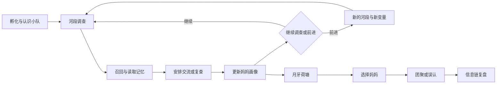

# 《Who is Mom》游戏策划方案

> 版本：0.2 / 一日原型版策划
>
> 类型：实时小队管理 + 间接取证 + 轻推理
>
> 平台：Web 浏览器
>
> 技术栈：TypeScript + Three.js + Vite
>
> Demo 目标时长：8-12 分钟
>
> 完整版单局目标时长：30-45 分钟

---

## 1. 项目概述

### 1.1 一句话介绍

玩家扮演一只领路的小鱼，带领一窝只有三格记忆、各有性格的小蝌蚪沿河寻找妈妈；玩家无法听见 NPC 的原始证词，只能通过分派调查、召回成员、安排对证和刷新认知，从小蝌蚪留下的二手记忆中判断哪只青蛙才是真正的妈妈。

### 1.2 核心体验

玩家管理的不是一组完全服从的单位，而是一群会主动行动、胆怯退缩、误解语境、互相说服和遗忘信息的“小型 AI Agent”。

游戏希望持续制造三种感受：

1. **照看感**：像放羊一样关注每只蝌蚪的位置、状态和行动倾向。
2. **推理感**：不直接判断一句话真假，而是判断“谁从谁那里、在什么情况下得到了这条记忆”。
3. **涌现感**：相同证词经过不同性格的蝌蚪理解和传播，会形成不同的小队认知。

### 1.3 设计问题

如何在一局 8-12 分钟的 Demo 中，让玩家至少两次因为“小蝌蚪的性格、信息来源或记忆传播方式”而改变自己的判断，并最终能够解释为什么某只青蛙更可能是妈妈？

### 1.4 三根设计支柱

| 支柱 | 玩家动作 | 设计要求 |
| --- | --- | --- |
| 分派与召回 | 选择合适的蝌蚪调查 NPC，并在必要时拉回 | 不同性格必须带来可预测的优势与风险 |
| 间接取证 | 从蝌蚪记忆而非 NPC 原话中获取信息 | 每条误导信息必须有可复盘的成因 |
| 管理认知 | 安排对证、复查、隔离或强化 | 交流既可能纠错，也可能制造错误共识 |

三根支柱合并为一句话：

> 玩家通过分派、召回和组织交流，管理一群不完整认知者共同寻找真相。

---

## 2. 背景故事

### 2.1 世界背景

初夏的一场暴雨冲开了上游的浅滩。一窝尚未孵化的蛙卵被水流带到陌生河段，蛙妈妈在追赶途中与它们失散。

雨停后，小蝌蚪们在下游荷塘孵化。它们来自同一窝，外表几乎完全一样，也还没有长出足以辨认品种的特征。它们只隐约记得水波、叫声和一个模糊的身影，没人知道妈妈究竟是什么品种、去了哪里、又穿戴着什么。

玩家扮演一只熟悉河道的领路小鱼，答应在天黑前把它们带到“月牙荷塘”。沿途的乌龟、螃蟹、蜻蜓和水鸟都可能见过某只青蛙，但它们提供的信息未必属于本地、未必发生在今天，也未必来自亲眼所见。

月牙荷塘里有数只正在等待孩子的青蛙。玩家必须根据一路形成的小队认知，选择其中一只作为妈妈。

### 2.2 玩家身份

Demo 暂定玩家角色为“领路的小鱼”。它本身不认识蛙妈妈，也不能直接与 NPC 交谈，只能：

- 带领蝌蚪移动；
- 指派蝌蚪与 NPC 接触；
- 召回正在自主行动的蝌蚪；
- 查看蝌蚪愿意表达出来的三条记忆；
- 安排蝌蚪围绕某个议题交流；
- 在终点替小队作出选择。

该身份只是功能性设定，后续可以替换为小鱼、水精灵或年长蝌蚪，不影响核心机制。

### 2.3 主题

主题不是“寻找妈妈”本身，而是：

> 领导并不等于替所有人思考，而是理解每个人如何理解世界，并帮助一群不完整的认知者共同接近真相。

### 2.4 叙事基调

- 温暖、轻松、略带童话感；
- 误解产生幽默，而不是恶意惩罚；
- 错误结局可爱但明确，让玩家愿意复盘；
- 不使用死亡、永久失去蝌蚪或沉重道德选择。

---

## 3. 核心玩法

### 3.1 玩家主要动词

**带领 → 观察 → 分派 → 召回 → 读取 → 对证 → 复查 → 决断**

其中玩家 80% 的时间应集中在四个核心动作上：

1. 选择哪只蝌蚪去调查；
2. 查看三格记忆发生了什么变化；
3. 安排哪两只蝌蚪讨论哪个议题；
4. 判断是否需要复查，还是带队继续前进。

### 3.2 移动与放羊感

- 游戏采用俯视 3D 视角。
- 玩家通过 `WASD` 或点击水面移动领路小鱼。
- 未执行任务的蝌蚪会以不同距离跟随玩家，形成松散队列。
- 胆小蝌蚪倾向贴近玩家；冲动蝌蚪容易偏离队列接近感兴趣的 NPC；亲和蝌蚪倾向靠近其他蝌蚪。
- 蝌蚪进入 NPC 的感知范围后，可能根据性格自主决定接触、等待或退缩。
- 玩家可随时点击蝌蚪并执行“召回”；若在调查完成前召回，则取消本次信息获取，避免可疑信息进入记忆。

### 3.3 NPC 调查

玩家无法直接点击 NPC 阅读对话。标准调查流程为：

1. 玩家靠近 NPC；
2. 选择一只蝌蚪；
3. 选择调查议题：**外貌、地点、来源**；
4. 蝌蚪移动到 NPC 附近并进行隐藏交谈；
5. 交谈结束后，蝌蚪生成一条自己的记忆；
6. 蝌蚪返回队伍，玩家才能在记忆面板中看到结果。

NPC 的原始文字永远不向玩家显示。玩家看到的是蝌蚪压缩、遗漏或解释后的第一人称记忆。

Demo 中一次调查只提取所选议题对应的一项观察。即使 NPC 同时知道外貌和地点，玩家也需要分别询问，或让不同蝌蚪分头取证。

### 3.4 行动资源

Demo 使用“天黑前剩余行动”作为简单压力：

- 初始拥有 7 点调查行动；
- 完成一次 NPC 调查消耗 1 点；
- 完成一次小组对证消耗 1 点；
- 查看记忆、移动和召回不消耗行动；
- 行动归零后进入最终选择阶段。

该设计避免玩家穷举所有 NPC、所有问题和所有蝌蚪组合，同时比实时倒计时更适合首个原型调试。

### 3.5 最终选择

调查结束后，玩家进入月牙荷塘，从三只候选青蛙中选择一只。

- 选择正确：妈妈认可小蝌蚪，全家团聚；
- 选择错误：候选青蛙温和地指出“你们不是我的孩子”，并说明哪条信息被误用了；
- 结算页面展示关键事实、NPC 原始信息、每只蝌蚪的记忆变化，以及错误认知的传播路径。

结算回放是推理公平性的重要组成部分，而不是额外剧情。

---

## 4. 游戏流程与循环

### 4.1 秒级循环：单次取证，约 20-40 秒

```text
发现 NPC
→ 选择调查者和议题
→ 观察蝌蚪主动、等待或退缩
→ 决定放任还是召回
→ 调查完成
→ 查看新增或被顶掉的记忆
```

### 4.2 分钟级循环：单个河段，约 3-5 分钟

```text
检查现有认知
→ 分派多名蝌蚪获得不同证词
→ 比较内容、来源与调查者性格
→ 安排对证或再次调查
→ 形成暂时的妈妈画像
→ 前往下一河段
```

### 4.3 单局循环：完整版约 30-45 分钟



### 4.4 Demo 流程，约 8-12 分钟

| 阶段 | 时间 | 内容 |
| --- | ---: | --- |
| 开场 | 30 秒 | 一句话交代目标，认识三只蝌蚪 |
| 自由移动教学 | 60 秒 | 移动、跟随、点击蝌蚪、查看空记忆槽 |
| 第一轮调查 | 2-3 分钟 | 接触三个 NPC，发现性格导致的不同行为 |
| 对证与复查 | 2-3 分钟 | 发现“红脚蓝背”缺少地点语境，安排讨论或复查 |
| 最终选择 | 1 分钟 | 从三只候选青蛙中选择妈妈 |
| 结算复盘 | 1-2 分钟 | 展示原始事实与记忆传播链 |

---

## 5. 信息与推理系统

### 5.1 五层信息模型


游戏不依赖“NPC 随机撒谎”，而依赖信息在传播过程中自然丢失语境。

### 5.2 信息偏差类型

| 类型 | 示例 | 玩家如何发现 |
| --- | --- | --- |
| 正确且本地 | 乌龟昨晚在芦苇湾见过戴荷叶帽的泽蛙 | 其他本地证据可交叉验证 |
| 正确但异地 | 蜻蜓在雨林见过红脚蓝背的树蛙 | 追问地点或来源 |
| 正确但过期 | 螃蟹三天前见过一只戴红围巾的牛蛙 | 追问时间，或观察当前痕迹 |
| 二手转述 | 水鸟听说有青蛙去了泥滩 | 追问是否亲眼所见 |
| 主观判断 | “叫声这么低，一定是大牛蛙” | 用直接观察推翻判断 |

一日 Demo 只实现前三种，故意欺骗和复杂二手传播留给完整版。

### 5.3 推理公平性规则

1. 世界真相、妈妈身份和 NPC 所知内容由确定性数据控制。
2. 关键事实至少存在两条独立验证路径。
3. 所有影响最终答案的错误记忆，都必须来自可解释的遗漏、过期、范围错误或性格偏差。
4. 大模型不得创建新的关键事实，不得修改妈妈身份。
5. 玩家看不到数值化“真假概率”，但可以看到蝌蚪记得的内容和它认为的来源。
6. 失败结算必须揭示原始证词和信息变形过程。

---

## 6. 小蝌蚪 Agent 设计

### 6.1 Demo 角色

| 名称 | 性格 | 自主性 | 信息优势 | 认知风险 |
| --- | --- | --- | --- | --- |
| 墨点 | 胆小谨慎 | 很低，通常等待命令 | 复述准确，愿意保留地点和来源 | 面对体型较大的 NPC 会退缩，不主动追问 |
| 小浪 | 勇敢冲动 | 很高，会接近感兴趣的 NPC | 抢到短暂信息，执行速度快 | 容易省略地点、时间和限定词，新鲜信息优先覆盖旧记忆 |
| 泡泡 | 好奇亲和 | 中等，偏好靠近同伴 | 容易追问背景，也容易让 NPC 多说 | 爱传播，可能把同伴的高确信表达当成事实 |

所有性格都必须同时拥有优势和缺陷，不存在单纯的“最优蝌蚪”。

### 6.2 Agent 状态机

Demo 中每只蝌蚪使用以下有限状态：

```text
FOLLOWING    跟随玩家
IDLE         原地等待
CONSIDERING  发现 NPC，依据性格决定是否行动
APPROACHING  前往 NPC
INTERACTING  隐藏交谈，显示进度但不显示内容
RETURNING    返回玩家身边
DISCUSSING   与另一只蝌蚪对证
```

自主行动只允许从预设动作白名单中选择，避免 Agent 做出游戏系统无法呈现的行为。

### 6.3 三格记忆

每只蝌蚪最多保存三条记忆。内部数据结构建议为：

```ts
type Memory = {
  claim: {
    subject: string;
    property: "appearance" | "location" | "source";
    value: string;
  };
  rememberedSource: string;
  scope?: string;
  confidence: number;
  salience: number;
  emotion: "calm" | "excited" | "afraid";
  createdAt: number;
  reinforced: boolean;
};
```

玩家界面只显示：

- 第一人称记忆摘要；
- 蝌蚪记得的信息来源；
- 新旧程度；
- 是否被同伴重复强化。

`confidence`、`salience` 等内部数值不直接展示，避免界面替玩家完成判断。

### 6.4 记忆替换规则

新信息进入时，根据性格选择被替换的槽位：

- **墨点**：优先替换最旧且未强化的记忆；受到惊吓时可能无法形成记忆。
- **小浪**：优先保留最新、最鲜明的信息，常用新信息顶掉旧信息。
- **泡泡**：优先保留被多人重复的内容，即使它只是错误共识。

完整版可使用统一权重模型：

```text
保留倾向 = 鲜明度 + 情绪强度 + 性格偏好 + 同伴重复
         - 记忆年龄 - 与当前观念的冲突成本
```

Demo 应使用明确规则而非随机权重，以便调试和复盘。

### 6.5 自主行为规则

- 墨点发现 NPC 后停在玩家身边并显示犹豫状态，只有明确指派才行动。
- 小浪进入蜻蜓或螃蟹的感知范围后，有较高概率自主靠近；Demo 为保证展示，可在第一次遇见蜻蜓时固定触发一次。
- 泡泡空闲时会靠近拥有新记忆的同伴，但不会未经玩家允许完成正式对证。
- 玩家可在交谈进度完成前召回小浪，从而阻止一条可能误导的记忆进入槽位。

这里的第一次自主行动应采用脚本保证出现，后续行为再由规则驱动。原型首先验证玩法表达，而不是随机系统的丰富度。

---

## 7. 对证与认知刷新

### 7.1 对证操作

玩家选择两只蝌蚪，并指定一个议题：

- 外貌；
- 地点；
- 信息来源。

两只蝌蚪进入短暂的讨论状态。玩家不直接选择结论，只能在讨论后查看记忆变化。

### 7.2 Demo 中的对证结果

| 条件 | 结果 |
| --- | --- |
| 两条记忆内容与来源一致 | 双方强化该记忆 |
| 内容冲突，但一方包含更具体的地点或来源 | 另一方降低原记忆确信，并生成带疑问的修正版 |
| 泡泡与表达鲜明的小浪讨论 | 泡泡可能复制小浪的说法，形成错误共识 |
| 墨点持有亲眼所见的本地信息 | 墨点较难被无来源的说法覆盖 |

### 7.3 刷新认知的方法

刷新不是点击“洗掉错误记忆”，而是执行有因果关系的行为：

1. 派另一只蝌蚪向同一 NPC 询问不同议题；
2. 让两只拥有矛盾记忆的蝌蚪对证；
3. 追问信息发生的地点或来源；
4. 在完整版中派蝌蚪实地观察脚印、叫声、卵壳或栖息痕迹；
5. 用新的直接经验逐步替代旧判断。

---

## 8. AI 原生机制与技术边界

### 8.1 为什么 AI 是核心而不是对白装饰

正式版中的 AI 不负责“多说几句随机台词”，而负责四件与玩法直接相关的事：

1. 根据性格和当前记忆决定是否自主行动；
2. 从 NPC 证词中选择自己注意到的部分；
3. 把信息压缩为有限记忆，并决定覆盖哪一格；
4. 在同伴交流中转述、质疑、接受或拒绝新认知。

如果移除这些能力，玩家就不再需要理解成员、设计队伍和管理传播链，核心玩法会消失。

### 8.2 确定性世界与生成式理解分层

```text
确定性层：妈妈身份、NPC 知识、地点、时间、候选青蛙、胜负
规则层：行动白名单、移动、记忆槽、消耗、状态机、结算
生成层：注意力选择、语义压缩、转述口吻、说服与反应
```

原则：**AI 可以解释事实，但不能创造真相。**

### 8.3 正式版 Agent 循环

```text
感知附近角色和事件
→ 读取性格、关系、目标与三格记忆
→ 从动作白名单中选择意图
→ 执行动作
→ 接收结构化观察
→ 形成或替换记忆
→ 在合适时机与同伴传播
```

大模型只在离散事件中调用，例如调查完成、对证开始和重大新证据出现时，不在每一帧调用。

### 8.4 建议的模型输出格式

模型必须返回受约束 JSON，并且只能引用请求中提供的事实 ID：

```ts
type EncodeMemoryResult = {
  task: "encode_memory";
  selectedFactIds: string[];
  omittedFields: Array<"time" | "place" | "source">;
  suggestedSlot: 0 | 1 | 2;
  tone: "calm" | "excited" | "afraid";
  spokenSummary: string;
};
```

输出必须经过 Schema 校验。客户端依据 `selectedFactIds` 重建结构化记忆，`spokenSummary` 只负责表达，不参与胜负判断。未知 ID、非法枚举、超长摘要或不可解析输出全部回退到本地规则。

### 8.5 浏览器端安全边界

- Three.js 只负责场景、角色表现和交互。
- 正式接入模型时，浏览器调用轻量服务端代理，API Key 不得放入前端代码。
- 服务端向模型发送结构化世界片段，而不是整个游戏状态。
- 每个事件保留本地规则回退，网络失败不应卡死游戏。
- 对相同事件和状态进行缓存，降低延迟与调用成本。

### 8.6 一日 Demo 的 AI 策略

一日 Demo 必须至少让真实模型参与两类离散事件：

1. 调查结束时，依据性格、旧记忆和允许事实压缩出新记忆；
2. 对证开始时，在两组已有记忆之间选择强化、质疑或修正关系。

玩家移动、跟随、自主接近、召回、行动消耗、妈妈身份和胜负仍由本地确定性规则控制。真实模型通过 Vercel Function 调用自有 OpenAI-compatible Chat Completions 接口，API Key 不进入浏览器代码。

模型响应只能引用请求中提供的事实和记忆 ID，并经过 Schema 校验。网络超时、输出非法或兼容接口不支持约束输出时，立即使用本地规则回退；同一次调查不重复扣行动点，游戏也不会卡死。

首日的 AI 验收标准不是对白更丰富，而是玩家能看到：同一组事实进入不同性格和不同三槽上下文后，会得到不同但可追溯的理解。

---

## 9. 完整版内容结构

### 9.1 妈妈档案

每局从以下字段生成一个隐藏妈妈档案：

```text
品种：泽蛙 / 树蛙 / 牛蛙 / 雨蛙等
身体特征：腹部颜色、腿部斑纹、体型、眼睛颜色
装扮：荷叶帽、花瓣披肩、红围巾、贝壳项链等
栖息地：芦苇湾、荷花池、泥滩、林下水洼等
行为：叫声、跳跃方式、食物偏好、迁徙方向
时间状态：今天的位置、最近是否更换装扮
```

候选青蛙之间应共享部分特征，不能靠单一线索直接作答。

### 9.2 河流关卡

完整游戏可包含 4-6 个连续河段：

1. 荷叶浅滩：学习分派和召回；
2. 芦苇窄道：视野受限，成员容易走散；
3. 泥沙岔口：不同路线提供互斥信息；
4. 林荫水湾：出现外地旅客和异地证词；
5. 水鸟领地：胆小性格和风险管理成为重点；
6. 月牙荷塘：综合判断并选择妈妈。

### 9.3 长线变化

- 不同品种与装扮组合改变妈妈档案；
- NPC 的旅行范围、观察时间和关系网络改变线索意义；
- 蝌蚪性格组合改变最佳调查策略；
- 多次共同经历可改变蝌蚪之间的信任关系；
- 蝌蚪成长后出现新的感知或行动能力。

这些内容不属于一日 Demo。

---

## 10. 一日 Demo 详细规格

### 10.1 Demo 验证目标

Demo 只回答一个问题：

> 玩家是否会因为“谁获得了什么信息，以及这只蝌蚪如何理解信息”而产生有意义的分派、复查和对证决策？

Demo 不验证商业化、长期成长、商业成品级美术、开放式自然语言输入或大规模模型成本，但必须验证真实模型可以安全地参与核心记忆循环。

### 10.2 固定案例

正确妈妈为：**戴荷叶帽、住在芦苇湾、腹部呈黄色的本地泽蛙**。

候选青蛙：

| 候选 | 外貌 | 装扮 | 地点 | 是否正确 |
| --- | --- | --- | --- | --- |
| A 红眼树蛙 | 红脚、蓝绿色背部 | 荷叶帽 | 林下水洼 | 否，装扮相同但属于雨林证词 |
| B 牛蛙 | 黄色腹部、体型大 | 红围巾 | 芦苇湾 | 否，外貌和地点相似 |
| C 本地泽蛙 | 黄色腹部、细腿 | 荷叶帽 | 芦苇湾 | 是 |

NPC：

| NPC | 隐藏的原始信息 | 信息类型 | 设计作用 |
| --- | --- | --- | --- |
| 旅行蜻蜓 | “我上周在雨林见过红脚、蓝绿色背部的树蛙。” | 正确但异地、过期 | 制造缺少语境的强烈误导 |
| 老乌龟 | “昨晚有戴荷叶帽的本地泽蛙往芦苇湾去了。” | 本地亲眼所见 | 分别提供装扮或地点线索 |
| 河蟹 | “我今天在石头边捡到一小片黄色蛙皮，脚印朝芦苇湾。” | 本地间接痕迹 | 分别提供外貌或地点的独立验证 |

每个正确特征都至少由一只错误候选共享：A 也戴荷叶帽，B 也有黄色腹部并位于芦苇湾。玩家必须组合至少两类证据，不能依靠单条记忆直接作答。

### 10.3 固定教学事件

1. 玩家第一次接近旅行蜻蜓时，小浪会自主上前。
2. 若玩家不召回，小浪获得“蜻蜓见过红脚蓝背的青蛙”，遗漏“雨林”和“上周”。
3. 玩家可派墨点追问“地点”；墨点需要明确命令，但会准确记住“那是在远方雨林”。
4. 玩家可让小浪与墨点讨论“地点”，使小浪的原记忆变成带疑问的版本。
5. 泡泡若先与小浪讨论“外貌”，可能复制“红脚蓝背”，展示错误共识。

这个事件必须稳定触发，因为它承担整个 Demo 的机制说明。

### 10.4 P0 必须完成

- [ ] 一个可移动的领路小鱼；
- [ ] 三只使用同一基础模型、具有跟随行为和可操作标记的蝌蚪；
- [ ] 三种固定性格及一次保证触发的自主行为；
- [ ] 三名 NPC 和三个调查议题；
- [ ] NPC 原始对话完全隐藏；
- [ ] 每只蝌蚪三个可查看的记忆槽；
- [ ] 记忆生成、覆盖和来源显示；
- [ ] 选择两只蝌蚪进行一次议题对证；
- [ ] 召回可中断尚未完成的自主调查；
- [ ] 7 点行动资源；
- [ ] 三只候选妈妈与最终选择；
- [ ] 正确、错误结局和信息链复盘；
- [ ] 重新开始按钮；
- [ ] 至少一次真实模型记忆编码和一次模型对证调用，失败时有确定性回退；
- [ ] 统一的程序化低模三渲二场景、角色和交互反馈；

### 10.5 P1 有时间再做

- 简单环境音和指令音效；
- 更多水面波纹、漂浮叶片和环境摆动；
- 第二个随机妈妈档案；
- 手机触控适配；
- 自动保存。

### 10.6 明确不做

- 不做开放世界河流；
- 不做战斗、捕食和生命值；
- 不做复杂寻路、NavMesh 或物理碰撞；
- 不做角色成长、装备和养成；
- 不做完整自然语言输入；
- 不做账号、联网排行和多人模式；
- 不制作复杂 GLTF 资产和骨骼动画；
- 不做实时阴影、SSAO、Bloom、景深或全屏描边；
- 不让在线大模型故障阻断游戏流程。

---

## 11. Demo 交互与界面

### 11.1 画面布局

- **中央 Three.js 场景**：河道、玩家、蝌蚪、NPC 和候选妈妈。
- **左侧小队栏**：三只蝌蚪的名称、性格图标、当前状态和三格记忆。
- **顶部状态栏**：剩余行动数和当前目标。
- **底部指令栏**：根据当前选择显示派遣、召回、查看记忆、安排对证。
- **结算层**：选择妈妈及信息传播复盘。

不使用大段常驻说明文字。首次操作通过高亮目标和短提示完成。

### 11.2 操作

| 输入 | 功能 |
| --- | --- |
| `WASD` / 点击水面 | 移动玩家 |
| 点击蝌蚪 / `1-3` | 选择蝌蚪 |
| 点击 NPC | 打开调查议题 |
| `R` | 召回当前蝌蚪 |
| 点击记忆槽 | 查看该蝌蚪的记忆摘要 |
| “安排对证”按钮 | 选择第二只蝌蚪和讨论议题 |

### 11.3 视觉反馈

- 蝌蚪头顶用图标表示：等待、犹豫、交谈、发现新信息、产生冲突；
- 新记忆进入时，左侧对应槽位短暂高亮；
- 旧记忆被覆盖时先淡出，再出现新记忆；
- 自主行动的蝌蚪出现短促波纹，提醒玩家它正在离队；
- 隐藏交谈只显示进度环，不出现 NPC 对话气泡；
- 对证后用连线短暂显示信息从谁传播给了谁。

### 11.4 美术指导与风格化渲染

#### 风格目标

游戏采用低面数 3D 与三渲二卡通色阶，参考《Lil Gator Game》明快、玩具感强的自然世界。借鉴的是视觉语言，而不是具体角色、场景或素材：

- 高饱和但分区明确的自然色彩；
- 大块色面、低分段几何和清楚剪影；
- 三段式明暗，弱化写实 PBR 高光；
- 角色使用大眼睛、夸张头身比和模块化装扮；
- 主要用色块、几何轮廓和局部深色细节分层，不依赖全场黑描边；
- 暖色岸地、青蓝水体、绿色植被、黄色树冠与浅紫天空共同构成多色自然环境。

#### 角色识别

三只蝌蚪来自同一窝，身体模型和主色保持一致。玩家通过叶片标记、选择环、UI 头像和动作辨认成员，避免用三种身体颜色破坏“外表几乎相同”的设定。

- 墨点贴近玩家，尾摆幅度小，遇到大体型 NPC 会后缩；
- 小浪处于队列前缘，尾摆快而大，发现目标时明显前探；
- 泡泡靠近同伴，移动带轻微弹跳，交流时绕同伴半圈。

候选妈妈共享同一青蛙基础结构，通过品种比例、腹部色块、腿部花纹和荷叶帽、围巾等低模装扮形成差异。关键推理特征必须在游戏相机距离下可见，不能只依赖 UI 文字。

#### 一日 Demo 表现边界

- 角色和环境均由 Three.js 基础几何程序化组合，不接入首日 GLTF 资产管线；
- 主材质使用 `MeshToonMaterial` 和三阶 `DataTexture gradientMap`；
- 几何使用低分段数、`flatShading`、共享材质和夸张比例；
- 灯光使用暖色 `DirectionalLight` 与冷暖 `HemisphereLight`；
- 角色脚下使用半透明扁圆假阴影，不开启昂贵实时阴影；
- 水面使用平面色块、轻微颜色脉动和池化波纹，不做反射折射；
- 交互高亮使用水面选择环和头顶状态符号，不使用全屏 Outline；
- 后处理 P0 为零，只有锯齿明显且有余量时增加一个 FXAA 或 SMAA Pass。

#### 视觉引导

- 河道暖冷边界和水面流向承担主要寻路，不用常驻文字箭头；
- 旅行蜻蜓的高位运动、老乌龟的稳定大轮廓和河蟹的横向动作形成不同注意力信号；
- 可调查 NPC 进入范围后才出现柔和水面环；
- 自主离队用动作加速和短促波纹捕获注意力；
- 月牙荷塘使用明亮树冠和开阔水面作为远景地标。

---

## 12. 扩展版完整流程与系统闭环

本节补充正式版预期。它不替换一日 Demo 的固定案例，而是定义 Demo 之后应扩展出的完整体验。

### 12.1 开始界面与开局建立关系

游戏不能直接把玩家丢进可移动场景。标准开局流程为：

```text
标题界面
→ 点击“开始旅程”
→ 15-25 秒孵化演出
→ 展示三只蝌蚪的本局性格卡
→ 玩家确认队伍
→ 基础移动与跟随教学
→ 第一只 NPC 出现
```

开始界面只保留三个主要入口：**开始旅程、继续游戏、设置**。点击开始后，固定主角小鱼先进入画面，三只蝌蚪从卵壳或水草后孵化并游到玩家身后。此时逐只展示：名字、两项显著性格、一个行动长处、一个当前担忧。玩家不分配属性点，避免在理解玩法前进行无意义优化。

### 12.2 本局蝌蚪生成

三只蝌蚪的名字、口吻、短期担忧和性格组合可由 AI 生成，但数值必须从本地平衡模板中抽取。AI 不得自由生成速度、能力倍率或规则外特质。

每只蝌蚪由四组数据构成：

| 层 | 示例 | 作用 |
| --- | --- | --- |
| 性格轴 | 主见、外向、谨慎、耐心 | 决定自主行动、交流和风险倾向 |
| 行动倾向 | 推撞、钻缝、清理、观察 | 决定障碍任务的基础适性 |
| 心理状态 | 自信、安心、困惑、疲劳 | 随经历变化，影响当前表现 |
| 表达风格 | 直白、吞吞吐吐、爱提问 | 只影响对白和记忆摘要表现 |

生成时必须满足队伍约束：至少一只高主见、一只高谨慎、一只高亲和；任一关键障碍至少有两种可行解法；三只蝌蚪都同时拥有优势与缺点。建议先由规则选出三个互补模板，再让 AI 为模板生成名字、语气和一句自我介绍。

### 12.3 跟随、自由活动与闲聊

空闲蝌蚪不会钉死在固定编队点，而是在玩家身后一个“安全跟随环”内活动：

- 每只蝌蚪有偏好的跟随距离、横向位置和游动噪声；
- 玩家静止时，它们会绕游、靠近同伴、观察环境或短暂发呆；
- 玩家移动时，它们先完成当前小动作，再回到安全跟随环；
- 超出最大距离会强制结束自由行为并追赶玩家，避免真正走失；
- 高主见者更常游到队伍前缘，高谨慎者贴近小鱼，高亲和者靠近其他蝌蚪。

闲聊分为三类，每次只显示一句或两句短对白，且设冷却时间，避免气泡刷屏：

1. **环境闲聊**：“这里的水越来越凉了。”
2. **目标闲聊**：“谁是妈妈？怎么还没找到？”
3. **记忆闲聊**：“小浪说她是蓝色的，可墨点明明说是在远方。”

只有第三类可能触发轻量记忆影响。普通气氛对白不能偷偷修改关键证据，否则玩家无法理解因果。

### 12.4 河流调查与多人派遣

发现动物后，调查可以由玩家指派，也可以由高主见蝌蚪提出或直接发起。自主行为必须先出现清晰预兆，例如头顶目标图标、朝 NPC 前探和一句“我去问问”，给玩家约 1.5-2.5 秒召回窗口。

玩家可派一、两或三只蝌蚪调查同一 NPC：

| 派遣人数 | 收益 | 风险与代价 |
| ---: | --- | --- |
| 1 只 | 消耗低，能针对性利用性格 | 只有单一理解，容易遗漏语境 |
| 2 只 | 可获得两个观察角度，回来后能立即比较 | 可能互相影响，内向者被强势同伴压住 |
| 3 只 | 更容易追问完整，能发现 NPC 的情绪和矛盾 | 队伍暂时无人协助玩家，NPC 可能应付或混淆话题 |

NPC 不统一拥有完整真相。每条信息都应标记其知识来源：亲眼目击、现场痕迹、二手转述、推测、过期见闻或错误归因。NPC 可以说错，但错误必须来自已定义的认知原因，而不是无提示随机撒谎。

调查结果由以下因素共同决定：

```text
获得信息 = NPC掌握内容 × 询问议题 × 调查者注意偏好
          × 当前自信/困惑 × 同行蝌蚪影响
```

性格只改变获得信息的方式，不直接等同于成功率。开朗者更容易让 NPC 多说，但可能跑题；谨慎者复述准确，但可能不敢追问；急躁者行动快，但容易抢答和省略限定词；内向者单独面对友善 NPC 也可能表现很好。

### 12.5 自信、困惑与记忆变化

为避免“选错蝌蚪就永久废掉”，心理状态采用可恢复的短期数值：

- **自信**：影响主动提问、障碍执行稳定性和表达完整度；
- **困惑**：来自连续冲突信息、错误共识或未解决的质疑；
- **疲劳**：来自连续派遣和障碍劳动；
- **安心**：来自回到玩家身边、被倾听、成功完成任务和证据得到验证。

内向蝌蚪交流受挫时降低自信，但玩家可以通过让它执行擅长任务、与友善 NPC 单独交流、在对证中采纳其正确观点或短暂休息来恢复。错误信息主要增加困惑，不应直接永久降低基础能力。

记忆变化必须有可见反馈：新增、覆盖、被质疑、被确认、被同伴转述。玩家至少要能查看“这条记忆从哪里来、何时变化、为什么变化”，但不显示精确真假概率。

### 12.6 召开对证与妈妈记录本

“召开对证”是随时可用但有条件限制的营地式短暂停顿。玩家打开入口后，小鱼与一至三只蝌蚪围成小圈，流程分为三步：

```text
选择议题
→ 听取每只蝌蚪的观点与来源
→ 玩家更新记录本，或标记“仍有疑问”
```

右侧记录本不是自动答案表，而是玩家的外部推理空间。字段建议为：

| 字段 | 可填状态 |
| --- | --- |
| 品种 | 未知 / 候选值 / 已确认 |
| 身体特征 | 多条标签，可标记冲突 |
| 装扮 | 候选值 / 已确认 |
| 出现地点 | 地图位置与时间 |
| 行为特征 | 叫声、食物、移动方向 |
| 信息来源 | 目击 / 痕迹 / 转述 / 推测 |

每条记录具有三种玩家标签：**暂记、确认、排除**。游戏只检查玩家最终选择，不立即判定记录对错；但在填入与现有记录冲突的信息时，用视觉连线提示冲突来源。对证可以改变蝌蚪记忆的确信状态，记录本则保存玩家自己的判断，两者不能合并成一个系统。

### 12.7 同伴传播

移动途中，蝌蚪可能围绕最近的新记忆交谈。传播规则需要满足：

- 只传播已存在的事实 ID，不创造关键事实；
- 玩家能看到传播发生，并能在记忆历史中追溯；
- 高亲和者更容易接受同伴说法，高主见者更难改变，高谨慎者更看重来源；
- 两只蝌蚪反复说同一件事只会提高“共识感”，不能把二手信息升级成亲眼目击；
- 已被玩家在对证中标记为“待查”的内容，传播时保留疑问标识。

### 12.8 事件、障碍与能力闭环

障碍的设计目标不是插入动作小游戏，而是让玩家把“我了解这只蝌蚪”转化为行动决策。基础障碍可分为：

| 障碍 | 适合倾向 | 其他解法 | 失败后果 |
| --- | --- | --- | --- |
| 漂浮木头 | 力量、耐心、协作 | 两只共同推；绕路 | 疲劳增加，耽误一次路段机会 |
| 松动石块 | 冲劲、观察裂缝 | 连续撞击；找水流机关 | 短暂害怕或自信下降 |
| 缠绕水草 | 灵巧、细心 | 两只从两侧拉开；寻找河蟹帮助 | 被困者无法参与下一次调查 |
| 浑浊急流 | 勇敢、跟随纪律 | 小鱼领航；分批通过 | 队伍短暂走散，记忆闲聊被打断 |
| 迷路支流 | 观察、可靠记忆 | 查记录本；向 NPC 问路 | 进入额外事件或消耗行动 |

任务表现由“基础适性 + 当前状态 + 协作关系”决定。连续接收互相冲突的妈妈描述会提高困惑，困惑过高时可能出现犹豫、选错用力方向或无法清楚协调，但不能让角色无缘无故失去物理能力。

每个障碍至少提供两种解法，并允许玩家撤回、更换成员或多人协作。失败应产生新故事和可恢复代价，不使用死亡或永久离队。

### 12.9 推荐核心循环

扩展版真正应反复发生的循环是：

```text
带队前进并观察成员状态
→ 遇见 NPC、事件或障碍
→ 根据性格、记忆和状态选择成员组合
→ 获得信息或改变队伍状态
→ 查看记忆变化与同伴反应
→ 对证并更新玩家记录本
→ 利用更清晰的认知解决后续问题
→ 继续前进
```

调查提供认知，认知影响协作，协作结果又改变自信与关系；这三者必须互相连接，才不会变成“对话系统、笔记系统、障碍系统”三个彼此无关的小游戏。

### 12.10 节奏与解锁顺序

首局不要一次开放所有系统。建议按以下顺序教学：

1. 开场：移动、自由跟随、查看性格；
2. 第一河段：单人指派与自主行动；
3. 第二河段：两人调查、错误信息与记忆变化；
4. 第一次对证：记录本只开放外貌和地点；
5. 第一个障碍：性格与当前状态影响行动；
6. 第三河段：同伴传播、三人调查和错误共识；
7. 第二次对证：开放来源、时间和排除标签；
8. 荷塘终局：用记录本检查候选并选择妈妈；
9. 结算：回放事实、记忆变化、玩家记录和关键决策。

每 2-4 分钟引入一个新变量，每次只要求玩家理解一个新因果关系。

### 12.11 当前原型与目标差距

截至版本 0.2，当前实现已经具备：固定小鱼、三只固定性格蝌蚪、性格化跟随、单人调查、三格记忆、两人对证、行动点、三只候选妈妈和结算。

尚未实现或与目标不一致的部分：

- 当前进入页面后立即开始，没有标题/开始界面和孵化演出；
- 三只蝌蚪为固定姓名与固定性格，不是规则约束下的本局生成；
- 跟随偏移是固定队形，尚缺少安全环内的自由活动轨迹；
- 缺少路上闲聊与可追溯的同伴自然传播；
- 调查只支持一只蝌蚪，尚不支持一至三只的组合派遣；
- 只有两人对证，没有小鱼主持、三人观点陈述和玩家记录本；
- 没有自信、困惑、疲劳和恢复机制；
- 没有障碍、事件、能力适性与协作解法；
- NPC 数据已有异地、目击和痕迹差异，但错误认知类型仍较少；
- 当前结算只展示证据日志，尚未回放完整记忆传播和玩家记录变化。

因此当前版本属于“间接取证垂直切片”，基本方向符合预期，但还不是完整的游戏流程。

## 13. Three.js 技术方案

### 13.1 技术选型

| 层 | 方案 | 理由 |
| --- | --- | --- |
| 构建 | Vite + TypeScript | 初始化快、类型约束有利于状态系统 |
| 3D | Three.js | 满足网页端 3D 表现和交互 |
| UI | 原生 HTML/CSS | 一日 Demo 无需引入 UI 框架 |
| 状态 | TypeScript Store + Command/Event | 状态可序列化、可复盘，避免状态库成本 |
| AI Demo | 远程模型 Adapter + 本地规则回退 | 真实参与核心循环，同时保证可玩性 |
| 服务端 | Vercel Function | 隐藏 Key，统一兼容接口和输出校验 |
| 部署 | Vercel | 同时托管 Vite 静态产物和 `/api/agent` |

### 13.2 建议目录

```text
api/
  agent.ts             Vercel 模型代理
src/
  main.ts              查询 DOM，创建并启动 GameApp
  app/                 装配入口、生命周期和帧循环
  core/                命令、事件、ID 和小型 EventBus
  game/
    case/              妈妈、候选、NPC 原始事实
    state/             GameState、Store 和规则
    agents/            跟随、状态机、自主行为
    memory/            三槽记忆、覆盖和对证
    interaction/       调查、派遣和召回
  ai/                  服务接口、远程 Adapter、Schema、回退
  render/              相机、灯光、材质、环境和角色工厂
  input/               键盘、Raycaster 和点击层
  ui/                  DOM HUD、记忆栏、指令栏、结算层
  styles/              UI Token 与布局
```

入口只负责装配；确定性真相、可序列化游戏状态和 Three.js 运行时对象必须分开。完整接口、事件流和文件职责见 `GAME_ARCHITECTURE_AND_PLAN.md`。

### 13.3 Three.js 场景范围

- 使用约 `38°` FOV 的透视相机，高位斜俯视并阻尼跟随玩家；
- 河流使用蓝绿色 Shape 或连续平面段，叠加少量池化波纹；
- 玩家、小蝌蚪、NPC 和青蛙均使用球体、圆锥、扁球等基础几何体；
- 角色用夸张比例、动作、叶片标记和简单配件区分，不加载外部模型；
- 角色、岸地和岩石使用共享的三阶 `MeshToonMaterial`，几何启用低分段和平面着色；
- 使用一盏暖色平行光和一盏半球光，角色用假阴影，不开启实时阴影；
- 使用 `Raycaster` 完成水面、蝌蚪和 NPC 点击；
- 移动使用目标点插值，跟随使用固定偏移和轻微摆动；
- 不使用物理引擎，不做复杂碰撞；
- 环境边界用距离限制实现。

### 13.4 系统接口

建议把 Agent 决策与记忆编码隔离为两个函数：

```ts
function decideAction(agent: Agent, context: AgentContext): AgentAction;

function encodeMemory(
  agent: Agent,
  observation: StructuredObservation
): MemoryUpdate;
```

自主行动首日由本地规则实现；记忆编码和对证通过 `RemoteAgentAdapter` 调用真实模型，并由 `LocalAgentFallback` 保底。两种实现保持相同输入输出结构。

### 13.5 性能目标

- 桌面浏览器 60 FPS；
- 首屏加载小于 3 秒；
- 无外部 3D 资源时构建产物尽量控制在 2 MB 以内；
- 同屏 Draw Call 少于 100、三角面少于 60k；
- 不使用实时阴影，P0 不使用全屏后处理；
- 支持 Chrome、Edge、Safari 近两个主要版本；
- 窗口缩放后 UI 和画布正确适配。

---

## 14. 一日开发排期

按一名熟悉 TypeScript 和 Three.js 的开发者、8-10 个有效工时估算。

| 时间 | 任务 | 完成标准 |
| ---: | --- | --- |
| 0:00-0:35 | Vite/TS 初始化、类型、Demo Case、GameApp | 项目可启动、构建、重开，真相数据可打印 |
| 0:35-1:35 | 透视场景、Toon 材质、灯光、河流、玩家 | 玩家可移动，相机跟随，画面已有统一低模风格 |
| 1:35-2:30 | 三只蝌蚪跟随、性格动作、选择与召回 | 外形同窝但行为可辨，召回有效 |
| 2:30-3:35 | NPC、Raycaster、派遣、自主接近和隐藏调查 | 小浪事件稳定触发，可中途召回 |
| 3:35-4:35 | 三格记忆、覆盖规则、来源链和小队栏 | 第四条记忆正确覆盖，变化可追溯 |
| 4:35-5:35 | Vercel 模型代理、输出校验、本地回退 | 至少一次真实记忆编码成功，失败仍可继续 |
| 5:35-6:25 | 对证、真实模型解析和认知刷新 | 蜻蜓案例完整可玩，雨林语境可被识别 |
| 6:25-7:10 | 候选妈妈、选择和结局 | 正确与错误结果均可触发 |
| 7:10-7:55 | 信息链复盘、提示和重新开始 | 完成一局后能理解误判原因 |
| 7:55-9:10 | 测试、性能检查、Bug 修复、Vercel 部署 | 无阻塞 Bug，线上可完整通关，密钥未泄露 |
| 9:10-10:00 | 接口和浏览器兼容缓冲 | 只修阻塞问题，不新增功能 |

如果进度落后，按以下顺序砍功能：

1. 砍声音、漂浮叶片和额外水面特效；
2. 砍任何后处理；
3. 砍点击水面移动，只保留 WASD；
4. 砍通用对证组合，只保留蜻蜓固定案例；
5. 不得砍三格记忆、性格差异、隐藏对话、召回、一次真实模型调用、对证和最终选择。

---

## 15. 验收标准

### 15.1 功能验收

- [ ] 玩家可以在浏览器中完整开始、游玩、结算和重开一局；
- [ ] 玩家始终看不到 NPC 的原始对话；
- [ ] 至少一只蝌蚪会自主行动，至少一只必须明确指挥才行动；
- [ ] 每只蝌蚪只有三个记忆槽，第四条信息会触发覆盖；
- [ ] 同一 NPC 信息经不同性格处理后得到不同记忆；
- [ ] 对证会改变至少一只蝌蚪的记忆或认知状态；
- [ ] 玩家可以通过追问地点识别蜻蜓证词不属于本地；
- [ ] 正确妈妈不能只凭一条未经复核的记忆稳定判断；
- [ ] 错误结算能指出错误信息来自哪条传播链；
- [ ] 全流程可在 12 分钟内完成；
- [ ] 至少一次记忆编码由真实模型完成，非法响应和网络失败会无缝回退；
- [ ] 世界使用统一低模三渲二视觉语言，三只蝌蚪外形同窝但动作性格可辨；
- [ ] 1080p 桌面浏览器保持 60 FPS，场景与 UI 不互相遮挡。

### 15.2 玩法测试问题

找 3-5 名未看过策划的玩家进行一次性黑盒测试，记录：

1. 玩家能否在 3 分钟内说出三只蝌蚪的行为差异？
2. 玩家是否至少主动召回或重新分派过一次蝌蚪？
3. 玩家是否理解“蜻蜓没有说谎，只是讲的不是本地蛙”？
4. 玩家是否使用过对证，而不是只靠穷举调查？
5. 选择妈妈时，玩家能否说出至少两条相互独立的依据？
6. 失败后，玩家是否认为结果可解释，而不是 AI 随机判错？

成功标准：至少 3/5 名玩家主动使用对证或复查，并能正确解释一条信息为何具有误导性。

---

## 16. 主要风险与应对

| 风险 | 表现 | 应对 |
| --- | --- | --- |
| 信息过于不透明 | 玩家觉得只能猜 | 显示记忆来源与传播变化，结算揭示全链路 |
| 规则过于透明 | 玩家直接把性格当数值公式 | 不显示概率，只用一致行为建立理解 |
| AI 产生无因错误 | 玩家无法公平复盘 | 世界事实结构化，模型只做受约束解释 |
| 玩家穷举所有问题 | 分派失去意义 | 使用有限行动点和互斥调查成本 |
| 聊天变成阅读负担 | 节奏被大量文本打断 | 隐藏 NPC 对话，记忆压缩为一句话 |
| 一日范围失控 | 做了场景但循环不完整 | 严守 P0，优先完成从调查到结算的闭环 |
| Three.js 美术耗时 | 基础模型不够精致 | 先统一 Toon 色阶、色盘、夸张比例、动作和假阴影，不接入资产管线 |
| 模型接口延迟或不兼容 | 调查等待过长或无法解析 JSON | 8 秒超时、只接受已知 ID、会话缓存和本地规则回退 |

---

## 17. Demo 之后的迭代顺序

如果一日 Demo 验证成功，建议按以下顺序扩展：

1. 增加第二个固定案例，验证机制不是只对蜻蜓谜题有效；
2. 将 NPC 事实、问题和候选妈妈改为数据驱动；
3. 增加蝌蚪关系与信任，使交流网络产生长期变化；
4. 增加模型调用回放、成本和稳定性监控；
5. 增加河流危险、走散与实地验证任务，强化放羊体验；
6. 将程序化角色逐步替换为优化后的低模 GLTF，并增加随机妈妈、品种和装扮。

真实模型首日即参与玩法，但验收时必须同时验证本地规则回退仍保留分派、召回和认知管理的决策。生成式 AI 应扩大有限上下文产生的差异，而不是替一个缺乏决策的循环制造表面变化。
